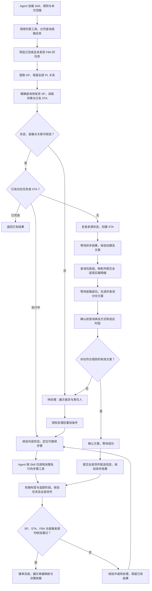
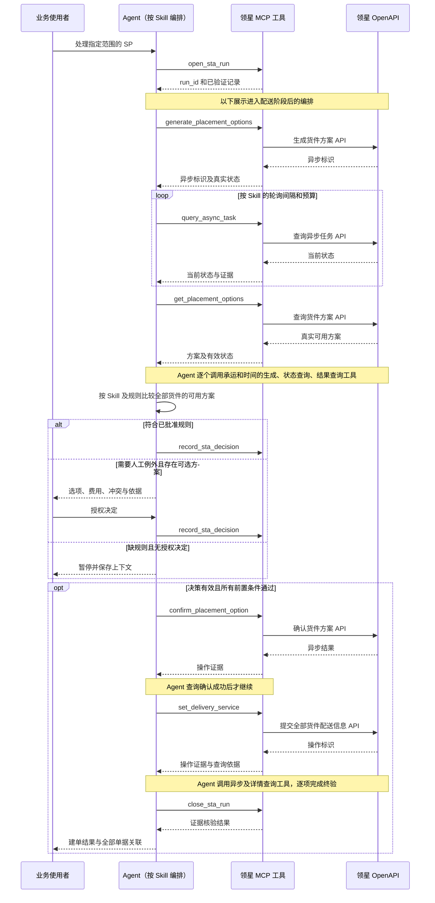
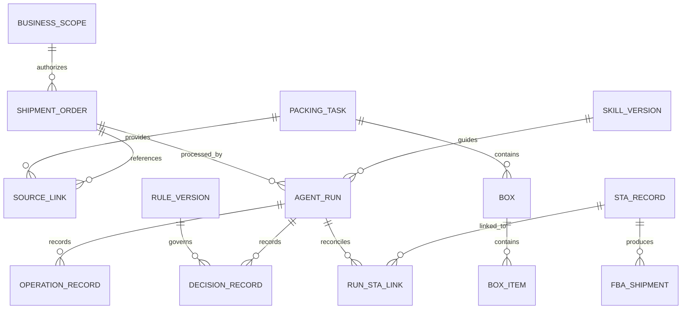

# 已完成装箱任务自动承接 STA / FBA 建单 — 产品需求文档

| 项目 | 内容 |
| --- | --- |
| 文档版本 | v0.2 |
| 编制日期 | 2026-10-23 |
| 作者角色 | 产品需求分析；依据业务输入编制，待业务负责人和 AI 部门评审 |
| 文档状态 | 评审稿；已核对公开接口文档，尚未完成实单联调 |
| 需求来源 | 用户提供的《AI 创 FBA 货件需求沟通纪要》、后续流程说明及截图、领星开放 API 文档 |
| 使用入口 | 公司 AI 中台 WorkBuddy |
| 已确认建设方式 | 领星接口逐项封装为 MCP 工具；Agent 按 Skill 中编排的流程逐步调用 |
| 业务负责人 | 供应链负责人、建单业务负责人，具体责任人待指定 |
| 产品与交付负责人 | AI 部门，具体责任人待指定 |
| 本期成果 | 从已有装箱任务和 SP 发货单出发，完成 STA 建单，并核验对应的全部 FBA 货件及单据关联 |
| 文档适用范围 | 需求评审、接口可行性验证、开发拆解和业务验收；不替代后续接口契约与技术设计 |

**证据标记：**

- **【业务确认】**：来自用户提供的会议纪要或后续明确描述。
- **【文档确认】**：截至 2026-10-23，在官方文档中查到相应能力或字段；不代表当前企业账号已获授权，也不代表实单已验证成功。
- **【方案建议】**：本 PRD 提出的产品范围、交互、控制规则或指标，需在评审时确认。
- **【待验证】**：现有材料不能证明，必须通过业务补充或真实接口联调确认。

除明确标记为业务事实或官方能力的内容外，本文件中的新增要求均为待评审的产品建议。文中的示例日期、仓库和单号不构成生产执行指令。所有量化验收目标均为建议值，尚非业务已承诺的 SLA。

**本版决策依据：**根据用户转述的领导要求，业务流程编排放在 Skill 中，由 Agent 负责执行。本版将接口工具、Skill、Agent 运行环境和持久记录的职责分别写清，并补齐接口清单与验证事项。项目专用业务规则和验收口径为本项目资产，不作为跨项目通用约定。

## 1. 产品目标与价值

### 1.1 需要支持的业务决策

本项目需要连续回答四个问题，并据此执行建单：

1. 哪些已完成的装箱任务对应尚未建成货件的 SP，当前可以处理？
2. 对这张 SP，应新建 STA、接续已有 STA，还是暂停并交给业务处理？
3. 当前真实可选的分仓、费用、承运方式和时间方案中，哪个符合公司规则？
4. 操作完成后，领星中的 SP、装箱任务、STA 和全部 FBA 货件是否正确对应，是否可以报告“建单完成”？

成功结果必须包含可核验的业务单据和关联证据，不能仅以 Agent 回复“已完成”、HTTP 请求成功或生成了一个 STA ID 作为完成依据。

### 1.2 已知现状与痛点

| 事实 | 证据与解释 |
| --- | --- |
| 公司继续使用领星 | 【业务确认】当前无替换领星 ERP 的计划。 |
| 已有上游作业链路 | 【业务确认】计划人员创建 SP 后推送 WMS 和中央库；WMS 完成打包并产生装箱数据，领星 SP 进入“待发货”。 |
| 重复操作量较大 | 【业务确认】会议称上半年 1—6 月，3 名主力员工共创建 7000 多票 SP，且存在加班；会议未明确年份，也未拆分本项目所覆盖环节的工时。 |
| 原有 MCP 能力不能直接覆盖 | 【业务确认】会议认为现有领星官方 MCP 以查询为主；【文档确认】领星 OpenAPI 中存在创建 STA、提交装箱、确认方案等写接口。MCP 工具覆盖情况与 OpenAPI 能力应分别判断。 |
| 关键经验尚未形成完整规则 | 【业务确认】仓库、日期有既有选择方法；【待验证】排序、阈值、排除条件和例外尚未提供。 |
| 公司希望后续复用能力 | 【业务确认】本次接入 WorkBuddy，并保留上云基础，未来供不同 Agent / 数字员工组合调用。 |
| 流程由 Agent 按 Skill 编排 | 【业务确认】用户转述领导要求：把领星各个接口封装为 MCP 工具，由 Agent 按 Skill 中的工作流程调用，完成整个任务。 |

不能直接以“7000 票 ÷ 3 人”推导可替代岗位数；需先测量本项目范围内的人工操作时间和异常占比。

### 1.3 目标与成功指标

| 目标 | 指标与建议验收口径 |
| --- | --- |
| 打通真实单据闭环 | 先完成 1 票经业务指定的真实单据，核验 SP、PL、STA、全部 FBA 编号和装箱一致性；再进入代表性样本试点。 |
| 提高处理效率 | 先建立人工基线；建议在规则完整、输入有效的同类订单上，将人工实际操作时间中位数降低至少 50%。等待上游系统响应的时间单独统计。 |
| 避免重复建单 | 重复指令、并发请求、超时重试和服务重启的专项验收中，重复创建 STA / 重复确认方案为 0。 |
| 保证结果可追溯 | 试点内 100% 的已处理 SP 可追溯到输入 PL、执行记录、规则版本和结果；存在未确认关联时不得标记成功。 |
| 让异常可处理 | 试点中 100% 的暂停或失败任务提供原因、当前已产生的外部结果和允许执行的下一步。 |
| 支持恢复、上云与复用 | 试点中 100% 的中断任务有持久记录；重新启动 Agent 后能查询外部真实状态并接续。MCP 可远程部署；Agent 持续后台运行由其宿主平台提供，不能仅凭 MCP 上云推断具备。 |

**指标定义：**自动完成率 = 无人工介入且核验通过的票数 / 规则覆盖且输入合格的票数。另行报告“全部扫描 SP 的完成占比”和排除原因，避免仅以合格样本掩盖上游数据问题。规则覆盖率和自动完成率的正式目标由试点后确定。

### 1.4 本期范围与阶段

| 阶段 | 纳入范围 | 退出条件 |
| --- | --- | --- |
| G0：链路验证 | 1 票真实 SP / PL；接口权限；创建与关联；装箱转换；异步结果核验 | 证明所需接口能逐项封装为工具，并由 Agent 按 Skill 达到领星页面的业务效果，或明确具体缺口。 |
| G1：最小闭环 | 指定店铺与站点、已完成装箱任务、已有待发货 SP、规则覆盖订单；交付接口级 MCP 工具、建单 Skill、Agent 配置及记录 / 恢复能力 | P0 验收通过；建议至少 10 票经业务选定的代表性有效样本，加上异常专项用例。 |
| G2：扩展优化 | 扩大店铺、场景与规则覆盖；结果导出、标签获取、效率分析 | 根据 G1 数据另行确定，不预先承诺日期。 |
| 后续数字员工 | 定时主动扫描、跨 MCP 编排、跨业务任务协同 | 单独评审授权范围、调度规则和运营责任。 |

本期从已有 SP 和已有装箱数据开始。新建 SP、WMS 实物打包、库存扣减、实际发货、自动打印标签、编造或自动上传尚不存在的物流跟踪号均不在范围内。

本期逐项封装第 10 节列出的建单链路所需领星接口，工具可供其他 Agent 复用。“各接口封装”的本期范围据本项目流程确定；领星采购、广告、财务等无关接口的全量建设需另行排期。工具服务与 Agent 均保留迁移至公司云环境的条件，不以开发者电脑常驻作为生产运行方式。

## 2. 用户角色与权限矩阵

以下为【方案建议】。权限应在服务端校验，不能依赖聊天提示词或 Skill 自律。

| 角色 | 查看候选与任务 | 发起 / 接续建单 | 处理业务例外 | 发布业务规则 | 配置接口与运行环境 | 查看审计 |
| --- | --- | --- | --- | --- | --- | --- |
| 建单人员 / 计划人员 | 授权店铺范围 | 授权店铺范围 | 按授权选择方案、补充事实 | 提交建议 | 无 | 自己或授权范围 |
| 仓库数据负责人 | 按职责查看装箱问题 | 无 | 在源系统修正装箱数据 | 无 | 无 | 相关数据问题 |
| 业务负责人 / 供应链负责人 | 所辖范围 | 所辖范围 | 决定规则外方案及费用例外 | 审核并发布 | 无 | 所辖范围 |
| AI 部门 / 运维人员 | 运行状态、脱敏错误 | 仅获单独业务授权时 | 技术恢复，不代决业务选项 | 管理版本，不代定业务阈值 | 有 | 技术审计 |
| Agent / 数字员工服务身份 | 继承调用主体授权范围 | 在已批准规则与权限内 | 提交需人工处理事项 | 无 | 无 | 当前任务需要的最小信息 |
| 审核人员 | 授权范围只读 | 无 | 无 | 无 | 无 | 授权范围 |

**授权规则：**

- 用户身份、所属公司、店铺和操作权限必须传递并校验；共享 MCP 服务不能等同于共享全部领星权限。
- 预先授权范围内、规则明确且校验通过的建单可直接执行，无需每一页面重复人工确认。
- 规则缺失、规则外费用、存在歧义或不可确认的外部执行结果时，暂停相应 SP，交给有权限的人处理。
- 如企业当前仅有一个使用组织，仍须保留明确的组织与店铺边界；是否建设多租户运营能力不属于本期前提。

## 3. 用户故事

| 编号 | 用户故事 | 关联需求 |
| --- | --- | --- |
| US-01 | 作为建单人员，我希望按装箱任务日期和店铺找到已完成、尚无 FBA 货件的任务，以确定本次处理范围。 | FR-01、FR-02 |
| US-02 | 作为建单人员，我希望同一 SP 下的多个装箱任务被完整保留且只产生一个建单处理入口，以避免漏箱和重复建单。 | FR-03、FR-04 |
| US-03 | 作为建单人员，我希望系统发现已有 STA 时能识别进度并接续，以免再次从头创建。 | FR-04、FR-10 |
| US-04 | 作为建单人员，我希望从 SP 商品直接进入 STA 装箱，自动带入已有装箱数据，以免反复输入单号和箱明细。 | FR-05、FR-06 |
| US-05 | 作为业务负责人，我希望仓库和费用按明确规则比较，并展示选择依据，以保证建单符合业务要求。 | FR-07、FR-13 |
| US-06 | 作为建单人员，我希望系统区分发货日期与送达时段，并使用有效承运方案，以避免提交错误日期或过期选项。 | FR-08 |
| US-07 | 作为建单人员，我希望最后两个步骤按现有业务范围完成，并看到全部 FBA 单号及原 SP 关联，以确认本票已经建好。 | FR-09、FR-16 |
| US-08 | 作为业务负责人，我希望异常给出原因和可执行选项，批次中其他独立订单仍可继续，以避免一票问题阻塞全部工作。 | FR-10、FR-16 |
| US-09 | 作为 WorkBuddy 使用者，我希望 Agent 按 Skill 调用各个 MCP 工具执行建单，中断后也能依据记录继续，以免重新从头操作。 | FR-11、FR-12、FR-15 |
| US-10 | 作为运维人员，我希望能按任务定位异步调用、令牌失效和数据变更，同时不接触明文凭据，以便恢复任务。 | FR-10、FR-14 |
| US-11 | 作为未来数字员工的建设者，我希望各个领星接口成为可独立调用的工具，流程通过 Skill 组合，以便其他 Agent 复用。 | FR-11、FR-15、FR-21 |
| US-12 | 作为供应链负责人，我希望获得人工工时、自动完成率和主要异常数据，以决定扩展范围与排期。 | FR-16、FR-19 |

## 4. 功能需求清单

### 4.1 需求总表

| 编号 | 优先级 | 功能 | 必须产生的业务结果 |
| --- | --- | --- | --- |
| FR-01 | P0 | 扫描候选装箱任务 | 按明确日期口径完成分页，筛选已完成任务，输出 PL、相关 SP 及候选 / 排除原因。 |
| FR-02 | P0 | 查询待发货 SP | 用提取的 SP 精确匹配，核验未删除、待发货、店铺与现有货件关系。 |
| FR-03 | P0 | 关联与装箱预检查 | 保留全部 PL—SP 关系，校验商品、数量、箱号、尺寸、重量和必要资料，输出可执行或待处理结论。 |
| FR-04 | P0 | 防重复与已有 STA 接续 | 同一业务范围仅有一个活动执行；对已有外部结果先核验，再接续或返回已有结果。 |
| FR-05 | P0 | 创建 STA / 选择发货商品 | 基于校验后的 SP 商品创建任务，保存 STA 编号和异步操作记录，并验证原 SP 的承接关系。 |
| FR-06 | P0 | 提交商品装箱 | 沿用当前上下文，将真实装箱明细正确映射至全部包装组并核验成功。 |
| FR-07 | P0 | 生成与选择入库配置 | 获取有效选项，按批准规则评估仓库、拆分和费用；记录选择证据。 |
| FR-08 | P0 | 完成配送服务 | 按规则为全部货件选择发货日期、送达时段和承运方式，完成方案确认与配送提交。 |
| FR-09 | P0 | 建单完成核验 | 完成当前范围内标签 / 追踪页面的业务衔接，核验全部 FBA 编号、数据和原 SP 关联。 |
| FR-10 | P0 | 异常、恢复与接管 | 区分可重试、需决策、结果不明和不可执行；从已验证步骤继续，保留外部已产生结果。 |
| FR-11 | P0 | 领星接口级 MCP 工具 | 第 10 节 P0 接口逐项提供可独立调用的工具，具有明确的参数、结果、权限、前置条件与错误语义。 |
| FR-12 | P0 | Skill 流程编排与 Agent 执行 | Skill 明确步骤、条件、循环、参数传递、决策和恢复方式；Agent 逐步调用工具完成全流程，不将全流程隐藏在单个建单工具中。 |
| FR-13 | P0 | 业务规则与版本 | 仓库、费用、日期、承运商等规则可配置和版本化；每次决策保留使用的版本。 |
| FR-14 | P0 | 授权、凭据与审计 | 校验操作权限；服务端管理领星鉴权；保存可定位且脱敏的审计记录。 |
| FR-15 | P0 | 持久记录、接续与上云基础 | 工具服务可远程部署，任务记录不依赖聊天记忆；Agent 中断后可重新加载 Skill、规则和记录接续；持续托管运行能力需核实平台支持。 |
| FR-16 | P0 | 任务状态与结果展示 | 查看每张 SP 的进度、暂停原因、已有结果及批次汇总；保留基础效率统计时间点。 |
| FR-17 | P1 | 结果导出 | 导出本次处理范围、单据映射、状态及失败原因。 |
| FR-18 | P1 | 获取箱标文件 | 按明确请求查询可用标签并提供文件；自动打印不在本需求内。 |
| FR-19 | P1 | 效率与异常分析 | 基于真实样本统计人工介入、等待耗时、成功率及主要问题来源。 |
| FR-20 | P2 | 定时自主处理 | 在单独批准的时间、店铺、额度和规则内主动扫描与执行。 |
| FR-21 | P2 | 跨业务数字员工编排 | 与其他 MCP 能力组合执行更大范围的业务任务。 |

### 4.2 候选筛选、关联与防重复规则

| 规则编号 | 判断规则与动作 |
| --- | --- |
| BR-01 | 日期筛选必须明确为“装箱任务创建日期”或“完成日期”，映射 `searchFieldTime=create/done`。用户截图的日期选择为创建日期；不能仅因标签页为“已完成”就改用完成日期。示例范围为 2026-10-01 至 2026-10-22。 |
| BR-02 | 装箱列表按全部分页读取，筛选 `taskStatus=3`。`packingCon=3` 仅代表全部装箱，不能替代“任务已完成”。文档未列出任务状态查询参数，不得假定可在请求中传状态完成筛选。 |
| BR-03 | “货件单号为空”应检查该任务及相关明细中的货件关联。任一有效关联已有 FBA 货件，均不得作为无货件的新建候选；字段缺失、空数组与尚未同步必须经详情和 SP 交叉核验。 |
| BR-04 | 提取与 SP 类型相符的关联单号，以店铺和 SP 等业务标识精确匹配待发货单。装箱日期条件不自动套用到 SP 创建日期，避免漏掉早于装箱创建的 SP。 |
| BR-05 | 同一 SP 关联多个 PL 时，保留全部映射并核验是否属于本次完整发货范围。多任务重复计箱、跨店铺、跨单据归属不清时暂停；仅按 SP 去重不能丢弃 PL 明细。 |
| BR-06 | 单张 SP 的候选明细必须与待发货商品、实际装箱和店铺一致。缺商品映射、数量不符、尺寸重量缺失、来源箱单位不明、同箱商品与包装组冲突时，报告具体差异。 |
| BR-07 | 区分：未发现 STA → 可进入创建；已存在同一业务的有效 STA → 核验后接续；已完成货件 → 返回已有结果；多个相互冲突 STA / 归属不明 → 人工判断。不能仅凭名称相同认定是同一任务。 |
| BR-08 | 启动写操作前再次读取关键状态，防止扫描后人工已经建单或修改装箱。重复请求和同时启动只返回同一活动任务；本系统互斥不能替代对外部人工操作的复查。 |
| BR-09 | 恢复任务允许已存在 FBA 编号。FR-01 的“货件为空”用于发现新候选，不得用它排除本系统已创建货件但尚未完成配送 / 关联核验的活动任务。 |
| BR-10 | 一个 SP 在本期通常对应一次活动建单执行；一个 STA 可能产生多个 FBA 货件。历史作废、重建保留记录，不能据此把外部关系硬编码成永久一对一。部分建单 / 部分发货的业务拆分须先确认范围，未确认时不自动拆单。 |

### 4.3 五步建单的产品行为

| 页面步骤 | 用户已确认的操作 | 自动化产品要求 | 关键边界 |
| --- | --- | --- | --- |
| 1. 选择发货商品 | 针对对应 SP 创建 STA | 从已核验 SP 获取商品、数量、店铺、发货地址与贴标 / 预处理责任方；创建或接续 STA | `invoiceSns` 在创建接口中指“发货计划编码”，不能把 SP 号直接填入当作绑定。 |
| 2. 商品装箱 | 创建 STA 后自然进入，引用已有装箱任务，不重复输入单号 | 从当前任务携带 PL / SP 上下文；读取真实箱明细；按 Amazon 包装组提交全部装箱数据 | 公开提交接口未列出 `taskSn` / `ptId` 参数。“装箱数据提交成功”和“领星记录引用了原 PL”是两个需分别核验的结果。 |
| 3. 配送服务 | 按既有方法选入库配置、时间，点下一步 | 获取真实可用选项，应用规则，完成方案确认及全部货件的配送服务提交 | SCK8 只是用户举例，不代表唯一仓库或正式优先级；费用、日期和承运商不能由模型临时猜测。 |
| 4. 箱子标签 | 当前只需下一步 | 核验当前链路可进入后续步骤；若接口不要求额外写操作，则不制造“点击下一步”对应接口 | 不要求自动打印。若租户流程存在必要确认动作，须在 G0 查清其接口或补充路径。 |
| 5. 货件追踪 | 当前只需下一步，结束建单 | 核验建单范围已完成，输出所有 FBA 编号与关联 | 不伪造跟踪号，不因“下一步”调用实际发货或库存扣减接口。 |

**业务完成定义：**商品及装箱正确、必要的分仓与配送操作已确认成功、全部货件可查询、原 SP 与结果关系已在领星核验、装箱来源可追溯。任一项待同步或关联不明，则为“核验中 / 待处理”。STA 状态 `ACTIVE`、`VOIDED`、`SHIPPED` 等是外部状态，本项目“建单完成”是独立业务结论，不要求转为 `SHIPPED`。

### 4.4 仓库、费用与时间的规则要求

规则由业务负责人提供并发布，至少表达以下内容；具体值见第 11 节待确认事项。

| 决策 | 必须显式化的规则 | 无法决策时 |
| --- | --- | --- |
| 选哪个分仓方案 | 允许仓库与区域、仓库排序、单仓偏好与费用的先后顺序、最大拆分数、禁选条件、并列方案处理 | 展示选项及原因，等待有权限的人选择。 |
| 是否接受费用 | 费用类型、币种、阈值、按票 / 件口径、例外授权人 | 不默认批准付费方案；不把入库配置费视为全部物流成本。 |
| 选什么发货日期 | 备货状态、截单时间、工作日 / 节假日、允许提前量和时区 | 缺少有效规则时暂停配送决策。 |
| 选什么送达时段 | 目的站点、预计运输周期、可选窗口、到期时间与例外条件 | 从官方返回的有效窗口中选择；不得生成接口未提供的窗口 ID。 |
| 选什么承运方式 | 自有 / 亚马逊合作承运商、运输方式、SPD / LTL 等货件服务类型、承运商与托盘要求 | 必填资料不足或方案不支持时暂停，明确需补充的字段。 |

`shipingTime` 是发货日期，`deliveryWindowOptionId` 及 `startDate/endDate` 是送达时段，二者必须分开决策和展示。领星文档对美国站送达窗口描述为周日到周六的 7 天区间；实际提交仍以目标站点当次返回的选项及其有效期为准。

### 4.5 MCP、Agent、Skill 与运行记录的分工

**【业务确认】Skill 编排流程，Agent 执行流程，MCP 工具执行对应接口动作。**【方案建议】一个领星 MCP Server 可提供多个工具；例如查询装箱任务、创建 STA、提交装箱分别是不同工具，无需每个接口单独部署一个服务。

| 层次 | 产品责任 | 责任边界 |
| --- | --- | --- |
| WorkBuddy / Agent | 加载当前 Skill 与规则；分页筛选、关联数据、选择下一步、发起工具调用、轮询、解释结果和处理例外 | 跨步骤编排在此发生；不得凭聊天记忆假定上一步成功。 |
| 建单 Skill | 定义输入、步骤、依赖、分支、循环、参数来源、业务规则引用、完成条件和接续方法 | 是可版本化的流程 SOP；不能替代服务端权限和数据校验。 |
| 领星 MCP 工具 | 单个工具对应一个领星业务 API 动作，提供参数约束、鉴权、错误转换、当前动作校验、幂等保护和审计 | 允许为当前动作做必要查询与技术处理；不隐式完成“创建→装箱→配送”等后续业务链。 |
| 执行记录与协调能力 | 持久保存任务上下文、调用结果、来源证据、规则版本、操作归属与单票互斥状态 | 支持 Agent 接续与避免冲突，不主动决定下一业务步骤。 |
| Agent 宿主环境 | 提供模型调用、工具连接、执行预算、等待与恢复能力；上云后提供持续运行条件 | MCP 在线不等于 Agent 在线；平台不支持后台运行时应显示暂停，等待重新启动后接续。 |

**接口封装约束：**

1. 第 10 节列明每个业务工具与领星接口的对应关系。工具名称是拟定名称，不表示领星已有同名 MCP。
2. 领星 AppID、AppSecret、令牌获取 / 刷新、签名和限流由工具服务内部管理；Agent 传业务参数，不能拿到明文凭据。
3. 写工具以服务端证据检查当前动作的前提，例如装箱未核验成功不得确认方案；不能仅相信 Agent 传入的“已完成”字段。检查失败时返回缺失证据和允许的动作，由 Agent 按 Skill 处理。
4. 写工具记录调用前的业务意图和调用后的真实结果；相同业务范围、动作和有效输入重复调用时返回已知结果或“待核验”，不能仅因 Agent 换了请求 ID 就再次执行。
5. 工具返回统一的结构化信息：调用结果、业务数据、原始追踪 ID、异步标识类型、可重试性、待核验原因和分页信息。保留来源字段语义，不能把未知字段映射成成功。
6. 查询与写入区别需明确。生成分仓、承运或送达方案会改变外部状态，不得把它们包装成“只读预览”。
7. 对装箱转换、数量求和、单位转换和复杂规则比较，允许提供确定性辅助函数 / 校验工具，保证重复输入得到一致结果；Agent 负责组合步骤。这些辅助能力不能隐式提交整票建单。

**执行记录辅助工具建议：**

| 辅助工具 | 目的 | 明确边界 |
| --- | --- | --- |
| `open_sta_run` | 为授权店铺与 SP 创建或认领运行记录，返回 `run_id`、已有结果和冲突情况 | 只登记 / 协调执行权，不创建 STA，不启动后台建单流程。 |
| `get_sta_run` | 查询上下文、工具调用证据、Skill / 规则版本及未决操作 | 读取持久记录；Agent 仍需用领星查询工具核对恢复所需的真实状态。 |
| `record_sta_decision` | 保存规则内选择或经授权的例外及其证据 | 服务端核验主体权限和选项；不能借此伪造接口成功状态。 |
| `close_sta_run` | 在外部结果与关联证据通过校验后结束本次运行 | 仅验证与记录完成结论，不补做整条业务链。 |

这些是本项目拟建设的辅助能力，不是领星公开 API。通用业务 API 工具仍可被其他获授权 Agent 独立调用；本项目写入范围必须有可追溯上下文，缺失时由工具要求补齐。

### 4.6 Skill 必须包含的流程契约

下列是未来建单 Skill 的交付要求，本 PRD 本身不代表已经安装或实现该 Skill。

| 步骤 | Agent 按 Skill 执行的动作 | 使用的工具 / 数据 | 进入下一步的条件 |
| --- | --- | --- | --- |
| S01 明确范围 | 读取授权店铺、日期类型和范围；缺少必要范围时补充 | 当前用户授权、任务输入 | 范围明确且在权限内。 |
| S02 获取装箱任务 | 循环分页，筛选已完成且未发现货件的任务，保存 PL—SP 关系 | `list_packing_tasks`、必要时 `get_packing_task` | 分页完整；缺失关联经过核验。 |
| S03 核验 SP | 精确查询待发货 SP、批量详情和箱明细；保留多个 PL | `list_shipment_orders`、`get_shipment_orders`、`get_packing_task` | 状态与商品、数量、箱数据一致。 |
| S04 建立执行上下文 | 认领运行、查历史结果；判断返回已有结果、新建或接续 | `open_sta_run`、`get_sta_run`、`list_sta_tasks`、`get_sta_task` | 无冲突活动执行；外部归属明确。 |
| S05 选择商品 / 创建 | 读取地址、预处理资料，构造有来源的商品数据；调用创建 | `list_ship_from_addresses`、按需 `get_prep_details`、`create_sta_task` | 创建异步成功；关联承接路径已验证。 |
| S06 商品装箱 | 查询包装组，转换当前 PL 实际箱数据，提交全部组 | `list_packing_groups`、`set_packing_information` | 提交异步成功且箱组成无差异。 |
| S07 生成与评估分仓 | 生成并读取方案与装箱预览，按规则初筛 | `generate_placement_options`、`get_placement_options`、`get_placement_box_info` | 有可继续核验的方案，或转待决策。 |
| S08 核验配送可行性 | 对拟选方案的全部货件生成 / 查询承运方式与送达窗口 | `generate_transport_options`、`get_transport_options`、`generate_delivery_windows`、`get_delivery_windows` | 全部货件的承运、发货日期和送达窗口符合规则。 |
| S09 确认并提交 | 保存选择依据；确认分仓成功后，提交全部货件配送信息 | `record_sta_decision`、`confirm_placement_option`、`set_delivery_service` | 两次写操作各自核验成功；过期则按 Skill 重新评估。 |
| S10 衔接与终验 | 核验标签 / 追踪阶段所需状态、全部 FBA 与原 SP 关联；必要时同步后重查 | `get_sta_task`、`get_shipment_details`、`get_shipment_boxes`、`list_shipment_orders`、按需 `sync_sta_tasks` | 满足第 4.3 节业务完成定义。 |
| S11 汇报结果 | 结束记录，输出每票结果和全部 FBA 编号；继续下一张独立 SP | `close_sta_run`、`get_sta_run` | 批次内所有票均有可解释状态。 |
| S12 中断 / 异常接续 | 读取记录和实际状态，定位未完成步骤；处理权限、规则或数据问题后继续 | `get_sta_run`、`query_async_task` 及对应详情查询工具 | 未知结果已澄清；必要人工决策已到位；不重放已成功动作。 |

S05—S09 等返回异步标识的调用，均由 Agent 按 Skill 调用 `query_async_task` 等已验证查询路径；在成功前不进入依赖步骤。Skill 须规定轮询间隔、最大等待时长、模型 / 工具调用预算和超限后的暂停状态，具体值经联调确定；工具侧统一执行接口限流。

首次交付支持一票完整执行，批量处理由 Agent 按 Skill 逐票循环，保持单票隔离。中断恢复时加载固定的 Skill 版本、规则版本和工具证据；流程版本升级不得静默改变正在执行的订单。

## 5. 非功能需求

下表数值均为【方案建议】，评审确认后作为验收目标；领星 / Amazon 延迟、企业网络条件与账号限额单独测量。

| 编号 | 维度 | 验收目标或约束 |
| --- | --- | --- |
| NFR-01 | 工具响应 | 建议基准负载为 10 个并发本地记录查询，P95 ≤ 5 秒；对领星的工具请求建议在 30 秒内返回结果、异步标识或明确的“结果待核验”。实际可用超时以企业 WorkBuddy 配置验证；不在一个工具调用内等待整票完成。 |
| NFR-02 | 持久恢复 | 已确认接收的执行记录和关键调用证据必须持久保存；恢复测试中，Agent 被重新启动且依赖可用后，建议 5 分钟内完成记录加载并开始真实状态核验。未知结果不盲目重放；不能承诺仅重启 MCP 即自动恢复 Agent。 |
| NFR-03 | 一致性 | 专项用例中重复建单为 0；成功任务中商品、数量、实际箱明细和全部 FBA 映射一致率 100%。 |
| NFR-04 | 权限隔离 | 越权访问店铺、任务和写操作的测试阻断率 100%；不能通过传入其他 `sid` 绕过。 |
| NFR-05 | 凭据保护 | AppSecret、access_token、refresh_token 和 MCP 访问凭据在 Agent 输出、Skill、项目文档、日志与版本提交中明文出现次数为 0；生产凭据仅由服务端受控配置获取。 |
| NFR-06 | 审计完整性 | 100% 外部写操作记录业务任务、操作者 / 服务身份、步骤、脱敏输入摘要、请求追踪 ID、异步 ID、结果与时间；保留期限由公司政策确定。 |
| NFR-07 | 外部限流 | 按领星对当前 AppID 与接口的实际限额协调调用；遭遇限流或鉴权错误不无界重试。重试次数与间隔可配置；超过预算转可处理异常。 |
| NFR-08 | 运行可迁移 | MCP 工具服务、Skill 和执行记录不依赖固定本机路径、浏览器登录态或单次聊天记忆；配置可外置。验收至少在 1 个公司指定远程测试环境验证工具连接、记录读取与 Agent 接续。 |
| NFR-09 | 可观测性 | 每票可区分等待 Agent、运行、等待上游、等待人工和核验耗时；由 `run_id` 定位最后确认步骤、未确认操作、Skill 版本、工具调用次数和模型用量（平台可提供时）。 |
| NFR-10 | 负载与 SLA | 领星 MCP 服务建议月可用性目标 ≥99.5%，以服务自身健康探测计算，外部依赖故障另报；正式 SLA、峰值并发、调用预算及 RTO / RPO 由企业运维评审确认。Agent 在线执行时长单独统计。 |
| NFR-11 | 编排一致性 | 在验收场景中，100% 具有业务副作用的动作可追溯至具体工具调用及 Skill 步骤；绕过已验证前置条件的写入次数为 0；语义相同的重复指令不得增加重复业务写入。 |

## 6. 核心业务流程图

### 6.1 从装箱完成到建单完成



图中各业务步骤由 Agent 按 Skill 调用对应工具，工具返回后由 Agent 判断下一步。“仅调用尚需执行的步骤工具”表示恢复入口，不重复前面已成功的写操作。每个异步步骤均需通过状态查询核验后再继续；恢复路径完成剩余必要动作后回到终验。

### 6.2 配送服务的关键顺序

依照领星“先装箱再分仓”官方流程，生成并读取分仓方案后，需要在**确认方案之前**核验其承运方式和送达窗口。确认其中一个方案会使其他方案失效，不能先选定仓库再假设承运与时间一定可用。



### 6.3 状态与异常处理

以下为本产品任务状态，不直接替代领星或 Amazon 的原始状态。

| 状态 | 用户含义 | 允许动作 |
| --- | --- | --- |
| 待校验 `VALIDATING` | 正在核验源单据和已有结果 | 查询；不能并发新建同一业务任务。 |
| 待执行 `QUEUED` | 已登记，等待 Agent 执行或接口额度 | 查询；不表示 MCP 已自行启动全流程。 |
| 执行中 `RUNNING` | Agent 正在按 Skill 执行某一步 | 查询；工具服务保存实际调用结果。 |
| 待接续 `PAUSED_AGENT` | Agent 会话结束、执行预算耗尽或宿主离线 | 重新启动 Agent，读取记录并核验外部状态后继续。 |
| 等待上游 `WAITING_EXTERNAL` | 写请求已返回异步标识，等待实际结果 | 轮询或核验，不重新创建同一步。 |
| 待决策 `NEEDS_DECISION` | 业务规则或输入不足 | 授权补充、选择有效方案。 |
| 待核验 `RECONCILING` | 外部可能已成功，或单据同步尚未确认 | 查询外部状态 / 同步；禁止盲目重放。 |
| 可恢复失败 `FAILED_RETRYABLE` | 已确认失败且存在允许的恢复方式 | 修复原因后接续，重新校验前提。 |
| 待人工处理 `BLOCKED` | 不支持、归属冲突或缺口暂无法自动解决 | 业务 / 技术接管，登记外部处理结果。 |
| 已完成 `SUCCEEDED` | 全部业务完成条件核验通过 | 查看结果；重复请求返回已有结果。 |
| 已跳过 `SKIPPED` | 不符合本次新建范围或已在别处完成 | 查看具体原因及已知结果。 |

鉴权失效、限流、网络超时、外部异步失败、选项过期、源数据变化和人工并行操作必须区分。认证重试不能无限循环；失败操作是否可重试由其真实结果与当前状态决定。

批次中每张 SP 独立执行和记录；公共权限失效等共享故障可以暂停相关范围。人工在领星中处理过的任务，恢复前必须重新查询，不能从旧快照继续。

Agent 停止不等于上游已受理的异步操作被取消。恢复时先核验这些操作；执行权过期或被另一 Agent 接管时也不能据此直接重放写入。

## 7. 关键页面原型说明

本期优先使用 WorkBuddy 对话中的结构化结果或卡片。以下为交互内容原型，**不要求另建管理后台**；按钮可由平台卡片或对应自然语言指令承接。所有示例标识和计数均为占位内容，不是实际运行结果。

### 7.1 候选清单

```text
待建单候选
店铺：[授权店铺]    日期口径：装箱任务创建日期
日期：2026-10-01 ～ 2026-10-22
扫描完整性：[已完成 / 仍有下一页]

SP          来源 PL          判断             原因
<SP-A>      <PL-A, PL-B>      可继续校验       待发货，未发现货件
<SP-B>      <PL-C>           接续已有任务     已有 STA，配送未完成
<SP-C>      <PL-D>           待处理           装箱数量与 SP 不符

[查看差异] [校验所选] [处理已校验候选]
```

空结果需区分“当前范围确无候选”“无权查看”“接口失败”和“尚未完成分页”。新候选与已存在活动任务分开展示，已有任务可由状态查询返回。

### 7.2 单票执行详情

```text
建单任务：<run_id>             状态：等待上游
SP：<SP-A>                    装箱来源：<PL-A, PL-B>
STA：<inboundPlanId>           规则版本：<rule_version>
流程版本：<skill_version>      Agent 状态：[运行中 / 待接续]

1 选择商品       已核验
2 商品装箱       已核验
3 配送服务       已提交，等待结果
4 箱子标签       待衔接
5 货件追踪       待衔接

已确认的 FBA 货件：[若已有则逐个列出]
最近更新：[时间]   当前说明：[业务可读说明]
[刷新进度] [查看商品与箱明细] [查看选择依据] [接续任务]
```

“已提交”不得显示为“已成功”。默认展示业务信息，原始接口追踪标识在排障详情中提供。

### 7.3 方案决策 / 异常处理

```text
<SP-A> 需要处理：未找到满足当前规则的方案
原因：[偏好仓不可选 / 费用超阈值 / 日期不匹配 / 规则未配置]

方案        仓库及拆分        配置费与币种        预计时间与有效期
<方案1>     <实际返回值>      <实际返回值>        <实际返回值>
<方案2>     <实际返回值>      <实际返回值>        <实际返回值>

推荐或排除依据：[规则条目及冲突]
需要处理人：[有对应权限的角色]
[选择有效方案] [补充资料后重验] [交由人工处理]
```

界面不应提供已经过期或不允许的选项。单次人工例外不自动改成全局规则；规则变更需按发布权限另行处理。

### 7.4 批次结果与追溯

```text
批次：<batch_id>    已完成：[n]    待处理：[n]    执行中：[n]

SP        STA        全部 FBA 编号           结果
<SP-A>    <STA-A>    <FBA-A1, FBA-A2>        已完成
<SP-B>    <STA-B>    <已产生编号>             待核验原 SP 关联
<SP-C>    —          —                       装箱资料不足

每票可查看：来源 PL、装箱核验、仓库、费用、日期、规则依据和处理记录
[查看待处理项] [查询指定 SP] [导出结果（P1）]
```

## 8. 数据实体初稿

### 8.1 最小必要对象

仅保留能支持“可否建单、如何选择、如何恢复、是否完成”的对象，不复制完整 ERP / WMS 数据模型。

| 实体 | 关键属性 | 存在原因 |
| --- | --- | --- |
| 业务范围 `BusinessScope` | 组织、调用主体、店铺 sid、站点、允许操作 | 决定谁可看、谁可写以及跨店铺隔离。 |
| 装箱任务快照 `PackingTask` | PL/taskSn、ptId、状态、创建 / 完成时间、仓库、来源版本 | 判断候选及追溯实际装箱来源。 |
| SP 快照 `ShipmentOrder` | SP、店铺、待发货状态、删除标记、商品及当前关系 | 判断本票业务身份和可处理条件。 |
| 来源关联 `SourceLink` | PL、SP、来源关系、核验状态及证据 | 保留多任务归并与关联歧义，避免去重丢失来源。 |
| 箱与箱内商品 `Box / BoxItem` | 源箱标识、数量语义、尺寸重量及单位、MSKU/FNSKU、商品数量、批次 / 有效期（如适用） | 保证软件提交与实物箱组成一致。 |
| Agent 执行记录 `AgentRun` | run_id、批次、调用主体、执行权、业务范围、SP、输入摘要、Skill / 规则版本、状态、当前步骤、最后核验时间 | 让 Agent 不依赖聊天记忆恢复，支持防重复与进度展示；记录本身不编排流程。 |
| STA 记录 `StaRecord` | inboundPlanId、店铺、外部状态、关联证据 | 接续和核验已创建任务；保留历史作废 / 重建关系。 |
| 货件 `FbaShipment` | 内部 shipmentId、shipmentConfirmationId、仓库、配送信息、外部状态 | 区分内部 ID 与 FBA 编号，保留一 STA 多货件。 |
| 操作记录 `OperationRecord` | run_id、工具名、步骤、请求标识、输入摘要、taskId / operationId、结果、错误、时间 | 由工具服务记录真实调用证据，判断异步完成、未知结果和是否能安全重试。 |
| 流程版本 `SkillVersion` | Skill 标识、版本、适用范围、步骤定义、发布日期、兼容工具版本 | 保证流程变更可追溯，恢复时采用明确版本。 |
| 规则与决策 `RuleVersion / DecisionRecord` | 规则版本、候选快照、选项有效期、理由、操作者、选定结果 | 解释“为什么选这个”，并支持例外审计与服务端写入检查。 |

### 8.2 关系草图



关系图允许保存历史与异常关联，不代表本期允许自动合并不同 SP 创建一个 STA。`RUN_STA_LINK` 是本产品追溯关系；其存在不能证明领星中的 SP—STA 关联已建立。

**数据约束：**

- 外部标识统一以无损方式保存。可能超过安全整数范围的长 ID 不转成浮点数；对外按接口契约转换。
- 商品不能仅靠名称或列表行号匹配，至少使用店铺、MSKU / FNSKU 和必要的批次 / 有效期属性。
- 装箱中的 `boxNum`、单箱数量、总数量和同规格多箱含义必须通过样本确认；不能未经验证直接相乘或展开。
- 不得为了满足包装组规则，在系统中虚构拆箱或重组箱内容；实际箱不兼容时返回仓库 / 业务处理。
- 保留源状态与读取时间。内容发生变化时使旧校验结论失效，重新确认本次执行范围。
- `shipmentId` 在不同接口中含义存在差异。STA 详情的 `shipmentId` 是内部货件 ID，`shipmentConfirmationId` 才是 FBA 货件号；适配层须按接口语义归一化。

## 9. 验收标准

### 9.1 P0 需求逐项验收

所有场景需保留输入样本、执行记录和外部核验结果。可用受控模拟验证失败与并发处理，但不能用模拟替代 G0 的真实关联与单据核验。

| 验收编号 | 对应需求 | 前提与动作 | 通过条件 |
| --- | --- | --- | --- |
| AC-01 | FR-01 | 准备跨多页、创建与完成日期不同、已完成 / 未完成、空 / 非空货件的装箱任务，分别按两种日期口径查询 | 完整读取目标范围；按真实状态与货件关系筛选；无漏页和误收；显示日期口径与排除原因。 |
| AC-02 | FR-02 | 从候选提取 SP，包含较早创建但仍待发货、已删除、已发货和其他店铺的 SP | 仅保留当前授权店铺符合条件的精确匹配；不因 PL 日期过滤掉合法 SP。 |
| AC-03 | FR-03 | 同一 SP 有多个 PL；分别注入重复箱、缺重量、商品数量不符和归属不明 | 合格数据保留完整来源；异常逐项报差异并阻止对应写操作；不丢箱、不重复计数。 |
| AC-04 | FR-04 | 对同一 SP 重复发起、同时发起，或存在未完成 / 已完成 / 归属不明的 STA | 不产生重复创建；返回或接续正确任务；归属冲突明确暂停。 |
| AC-05 | FR-05 | 使用一票已授权且资料完整的真实 SP 创建 STA，并等待异步结果 | 商品、数量、店铺、地址和责任方正确；保存真实 STA；原 SP 承接关系可在领星核验；不能用名称或本地映射代替关联证据。 |
| AC-06 | FR-06 | 从当前 STA 上下文提交包含多个包装组的真实装箱明细 | 无需用户重新输入 SP / PL；全部组提交成功；箱组成、数量、重量、尺寸与来源一致；PL 引用 / 承接效果有证据。 |
| AC-07 | FR-07 | 返回多个仓库、费用、拆分和过期方案，分别使用完整规则及缺失规则 | 选择结果符合已批准的排序及阈值；过期方案不提交；无合规选项时待决策；记录依据。 |
| AC-08 | FR-08 | 一 STA 产生多个货件，存在不同承运与时间限制 | 确认分仓前核验承运与窗口；全部货件配送信息均提交成功；发货日期与送达窗口分别正确；异步结果核验通过。 |
| AC-09 | FR-09 | 业务用户在当前租户完成对照流程，系统完成标签 / 追踪衔接与终验 | 所有 FBA 编号、配送结果和原 SP 关联可查，满足建单完成定义；不要求 SHIPPED，不调用库存扣减，不生成虚假跟踪号。 |
| AC-10 | FR-10 | 注入写请求响应丢失、异步失败、上游同步延迟，以及恢复时已有 FBA 的情形 | 未知结果先核验；已成功步骤不重复执行；恢复任务不被“货件非空”候选规则排除；给出明确处理动作。 |
| AC-11 | FR-11 | 在实际 WorkBuddy 版本发现并逐项测试第 10 节 P0 工具；分别调用创建、装箱、确认工具 | 每个业务 API 有独立工具与契约；调用创建只产生创建动作，不隐式提交装箱和配送；权限、参数及错误语义可验证。 |
| AC-12 | FR-12 | 用交付 Skill 测试正常发起、已有任务、缺规则、失败和完成五类对话，并审查调用轨迹 | S01—S12 所需分支、循环、参数传递及轮询由 Agent 执行；工具调用轨迹能对应步骤；不猜参数、不绕过暂停，结果汇报有工具证据。 |
| AC-13 | FR-13 | 用相同选项验证两个规则版本，并在任务执行中发布新版本 | 可解释版本导致的选择差异；活动任务不被静默切换规则；人工例外不自动成为全局规则。 |
| AC-14 | FR-14 | 使用不同权限主体调用其他店铺任务，模拟令牌过期和并发刷新，检查输出与日志 | 越权均被阻断；刷新行为受控；凭据不泄露；每次外部写操作可追踪到主体及任务。 |
| AC-15 | FR-15 | 在远程测试环境调用工具；创建或提交装箱后中断 Agent，再以固定 Skill 版本重新启动 | 工具服务和记录可远程访问；新会话读取上下文，先查外部结果，再调用下一步；记录不丢失、不重复写入；满足 NFR-02。持续后台运行另按宿主能力验收。 |
| AC-16 | FR-16 | 批次同时包含成功、等待上游、待决策、失败和多 FBA 货件的任务 | 每票状态、完整单据映射和批次汇总准确；一票异常不误标整批成功；基础耗时可计算。 |

### 9.2 补充业务与接口验收

| 验收编号 | 场景 | 通过条件 |
| --- | --- | --- |
| AC-17 | 扫描完成后，人工修改 SP / 装箱或在领星创建 STA | 写前识别源状态变化；重验或暂停；不能继续使用失效校验。 |
| AC-18 | 领星接口返回 HTTP 200，但业务失败或异步仍在处理 | 系统准确区分 HTTP、业务响应和异步执行三层结果，不提前进入成功状态。 |
| AC-19 | 配送接口返回 `operationId`，状态查询要求 `taskId` | 用真实账号确认正确的状态查询方法并记录契约；无证据时不得假定两个字段可互换或绕过核验。 |
| AC-20 | 方案已失效，或待人工决策期间方案发生变化 | 重新获取并评估有效选项；不得提交旧选项或悄悄换成其他费用 / 仓库。 |
| AC-21 | 多箱数据包含单位差异、长整型标识和特殊商品信息 | 标识无精度损失，单位转换正确，数量无重复展开；不兼容箱组不虚构调整。 |
| AC-22 | 真实试点完成后核算效果 | 按第 1 节口径统计人工操作时间、等待时间、合格样本自动完成率、全量完成占比和排除原因，提供可复查明细。 |
| AC-23 | Agent 跳过步骤，或把自述“成功”写入恢复上下文后直接调用下游写工具 | 工具服务依据真实证据拒绝不满足前提的动作，返回缺失条件；拒绝率 100%，不会自动代执行被跳过的步骤。 |
| AC-24 | 两个 Agent 使用不同请求标识同时处理同一 SP，或更换 Agent 接续已超时操作 | 服务端业务范围互斥与结果核验生效；未知结果先查询；不因新会话 / 新请求标识产生重复 STA。 |
| AC-25 | 执行期间更新 Skill，或单次 Agent 运行达到调用 / 时间预算 | 当前运行保持版本可追溯；停止后状态明确可接续；不能无限轮询，也不能将暂停报告为完成。 |

### 9.3 评审与交付门槛

- **G0 必须先通过：**创建接口权限、SP / PL 的关联与承接、真实装箱转换、异步状态查询、当前租户最后两步的完成语义。若需要补充接口，应先形成可验证路径。
- **G1 必须通过：**全部 P0 对应 AC-01 至 AC-16，以及 AC-17 至 AC-21、AC-23 至 AC-25；规则覆盖范围与允许店铺已批准。
- **验收材料：**接口—工具清单、建单 Skill、Agent 配置与调用轨迹、真实样本的脱敏单据对应表、核验记录、Skill / 规则版本、异常处理记录、WorkBuddy 操作说明和部署 / 恢复说明。
- **未通过时的交付状态：**只能标记“部分能力可用 / 接口验证中”，不能宣传“已实现全自动闭环”。业务负责人确认业务结果，AI 部门确认接口证据与运行恢复能力。

## 10. 依赖与约束

### 10.1 外部与组织依赖

| 依赖 | 当前证据与约束 | 负责协调方 |
| --- | --- | --- |
| 领星应用与接口权限 | 需有效 AppID、AppSecret、店铺授权和接口权限，并按开放平台要求配置出口 IP 白名单；本次仅查阅公开文档，未取得或使用企业领星凭据。 | 企业领星管理员、AI 部门、领星支持 |
| 已有 WMS / 中央库链路 | 本期优先使用领星内已有装箱及 SP 数据；若数据完整，不要求另取 WMS / 中央库接口或系统源代码。缺失字段先核实已有链路和数据归属。 | 仓库系统负责人、业务负责人 |
| 业务 SOP 与规则 | 仓库、费用、日期、承运方式的判断方法需转为有版本的规则，再由 Skill 引用；当前仅获得原则与示例。 | 建单业务负责人、供应链负责人 |
| WorkBuddy 接入 | 官方连接器文档支持 MCP + Skill；公司的实际版本、工具权限、认证方式、上下文容量和执行预算需实测。 | AI 中台负责人 |
| Agent 托管环境 | 持续后台执行、等待后唤醒、断点接续由 Agent 运行环境提供；本期必须保存可恢复证据并验证重新启动后的接续。 | AI 中台与运维负责人 |
| 云环境与网络 | 需公司指定可访问领星的运行环境、HTTPS 地址、凭据管理与记录存储能力；具体产品和技术栈留待技术设计。 | IT / 运维 |
| 试点与优先级 | 会议要求 AI 部门向供应链负责人“老吴”确认优先级，结合人力投入横向比较排期；目前未给出上线日期或开发人天。 | AI 部门、供应链负责人 |

获取 API 文档、应用授权、真实样本和联调支持是前提，**不要求取得领星系统源代码**。需要编写的是本公司的接口封装、Skill、Agent 配置以及必要的执行记录和校验能力。

### 10.2 官方流程与鉴权依据

接口核查基准日为 **2026-10-23**。下面的“文档存在”仅指官方文档公开列出该能力，企业权限、真实参数和页面等价效果仍需验证。

- 用户提供的文档入口：[领星 API 更新日志](https://apidoc.lingxing.com/#/docs/ApiUpdateLog)。
- 流程依据：[STA 货件流程说明](https://apidoc.lingxing.com/new/api-docs/Case/staProcessNew/)。本项目对应“先装箱再分仓”，创建参数按文档使用 `positionType=1`。该流程强调确认分仓前核验承运方式与送达窗口。
- 鉴权依据：[领星开放 API 对接指引](https://apidoc.lingxing.com/new/guides/new-instructions/)。AppID / AppSecret 用于取得令牌；业务 API 仍需 `access_token`、`app_key`、时间戳与签名。
- 接入依据：[WorkBuddy 连接器文档](https://open.workbuddy.cn/docs/connector)。一个连接器配置一个 MCP Server，服务可提供多个工具；远程接入使用 HTTPS，具体传输与认证按公司版本验证。

| 内部基础能力 | 官方文档 / 方法 / 路径 | 产品要求 |
| --- | --- | --- |
| 获取领星令牌 | [获取 access_token](https://apidoc.lingxing.com/new/api-docs/Authorization/GetToken/)；POST `/api/auth-server/oauth/access-token` | MCP 服务内部调用，按文档要求提交应用凭据；不作为向 Agent 返回明文密钥的工具。 |
| 刷新领星令牌 | [刷新 access_token](https://apidoc.lingxing.com/new/api-docs/Authorization/RefreshToken/)；POST `/api/auth-server/oauth/refresh` | 协调并发刷新，保存返回的新令牌；按文档处理 refresh_token 单次使用约束。 |

领星文档的令牌桶维度涉及 AppID 与接口路径，不能将“容量 1”直接解释为“每秒可调用 1 次”。多个 Agent 共享应用时，限流与令牌刷新由服务端统一协调。

### 10.3 领星 API 与 MCP 工具对应表

以下工具名均为**拟建设名称**，不是领星已提供的官方 MCP 名称。P0 表示本期应具备该能力；“按需调用”表示 Skill 根据数据和状态决定是否实际调用。除店铺列表为 GET 外，表内业务接口均为 POST。

| 编号 | 优先级 | 拟定 MCP 工具 | 官方接口文档与调用路径 | 用途 / 核验重点 |
| --- | --- | --- | --- | --- |
| API-01 | P0 | `list_amazon_stores` | [查询亚马逊店铺列表](https://apidoc.lingxing.com/new/api-docs/BasicData/SellerLists/)；GET `/erp/sc/data/seller/lists` | 获取店铺与站点资料；工具只返回调用主体获授权范围。 |
| API-02 | P0 | `list_packing_tasks` | [查询装箱任务列表](https://apidoc.lingxing.com/new/api-docs/Warehouse/PackingTaskList/)；`/basicOpen/packingTask/list` | `searchFieldTime`、日期、分页；筛选 `taskStatus=3`，保留 `relateSn` 和 `relateShipment`。 |
| API-03 | P0 | `get_packing_task` | [查询装箱任务详情](https://apidoc.lingxing.com/new/api-docs/Warehouse/PackingTaskDetail/)；`/basicOpen/packingTask/taskDetail` | 以 `ptId` 或 `taskSn` 查询箱明细与来源关系；确认箱数和单箱数量语义。 |
| API-04 | P0 | `list_shipment_orders` | [查询发货单列表](https://apidoc.lingxing.com/new/api-docs/FBA/GetInboundShipmentList/)；`/erp/sc/routing/storage/shipment/getInboundShipmentList` | 新候选使用 `status=0`、`is_delete=0`；`senior_search_list` 按 `shipment_sn` 精确匹配。 |
| API-05 | P0 | `get_shipment_orders` | [批量查询发货单详情](https://apidoc.lingxing.com/new/api-docs/FBA/GetInboundShipmentListMwsDetailList/)；`/erp/sc/routing/storage/shipment/getInboundShipmentListMwsDetailList` | 以 `shipment_sn_arr` 查询商品、数量、装箱和关联；单次上限按文档为 50。 |
| API-06 | P0 | `list_ship_from_addresses` | [发货地址列表](https://apidoc.lingxing.com/new/api-docs/FBA/ShipFromAddressList/)；`/erp/sc/routing/fba/shipment/shipFromAddressList` | 使用实际发货地址和联系方式，不由模型补造。 |
| API-07 | P0 | `get_prep_details` | [获取商品预处理信息](https://apidoc.lingxing.com/new/api-docs/FBA/GetPrepareDetails/)；`/amzStaServer/openapi/inbound-packing/getPrepDetails` | 按需核实商品预处理；不能与贴标责任方混淆。 |
| API-08 | P0 | `create_sta_task` | [创建 STA 任务](https://apidoc.lingxing.com/new/api-docs/FBA/CreateSTATask/)；`/amzStaServer/openapi/inbound-plan/createInboundPlan` | 商品、地址、责任方、分仓模式；返回 `inboundPlanId` 与异步标识；SP / PL 承接待验证。 |
| API-09 | P0 | `list_sta_tasks` | [查询 STA 任务列表](https://apidoc.lingxing.com/new/api-docs/FBA/QuerySTATaskList/)；`/amzStaServer/openapi/inbound-plan/page` | 核验已有任务；分页与创建 / 更新时间口径须明确；不仅凭任务名称认定归属。 |
| API-10 | P0 | `get_sta_task` | [查询 STA 任务详情](https://apidoc.lingxing.com/new/api-docs/FBA/StaTaskDetail/)；`/amzStaServer/openapi/inbound-plan/detail` | 核验任务、商品和全部货件；区分内部 `shipmentId` 与 `shipmentConfirmationId`。 |
| API-11 | P0 | `list_packing_groups` | [查询包装组](https://apidoc.lingxing.com/new/api-docs/FBA/ListPackingGroupItems/)；`/amzStaServer/openapi/inbound-packing/listPackingGroupItems` | 获取 `packingGroupId` 及商品归组，供当前 STA 装箱使用。 |
| API-12 | P0 | `set_packing_information` | [提交装箱信息](https://apidoc.lingxing.com/new/api-docs/FBA/SubPackingInformation/)；`/amzStaServer/openapi/inbound-packing/setPackingInformation` | 提交全部包装组及真实箱明细；没有已确认的 `taskSn` / `ptId` 直接引用参数。 |
| API-13 | P0 | `generate_placement_options` | [生成货件方案](https://apidoc.lingxing.com/new/api-docs/FBA/GenerateShipmentPlan/)；`/amzStaServer/openapi/inbound-shipment/generatePlacementOptions` | 生成外部分仓选项，属于写操作；成功后再查询。 |
| API-14 | P0 | `get_placement_options` | [查询货件方案](https://apidoc.lingxing.com/new/api-docs/FBA/ShipmentPreView/)；`/amzStaServer/openapi/inbound-shipment/shipmentPreView` | 获取仓库、拆分、费用、币种、方案状态及货件 ID。 |
| API-15 | P0 | `get_placement_box_info` | [查询货件方案的装箱信息](https://apidoc.lingxing.com/new/api-docs/FBA/getInboundPackingBoxInfo/)；`/amzStaServer/openapi/inbound-packing/getInboundPackingBoxInfo` | 核验方案下各货件箱明细与体积重量。 |
| API-16 | P0 | `generate_transport_options` | [生成承运方式](https://apidoc.lingxing.com/new/api-docs/FBA/GenerateTransportList/)；`/amzStaServer/openapi/inbound-shipment/generateTransportList` | 传入全部相关货件的发货资料；生成后查询异步结果。 |
| API-17 | P0 | `get_transport_options` | [查询承运方式](https://apidoc.lingxing.com/new/api-docs/FBA/GetTransportList/)；`/amzStaServer/openapi/inbound-shipment/getTransportList` | 按货件读取支持的服务类型、承运人和选项 ID。 |
| API-18 | P0 | `generate_delivery_windows` | [生成可选送达时间](https://apidoc.lingxing.com/new/api-docs/FBA/GenerateDeliveryDateList/)；`/amzStaServer/openapi/inbound-shipment/generateDeliveryDateList` | 按货件生成可用送达窗口；属于写操作。 |
| API-19 | P0 | `get_delivery_windows` | [查询可选送达时间](https://apidoc.lingxing.com/new/api-docs/FBA/GetDeliveryDateList/)；`/amzStaServer/openapi/inbound-shipment/getDeliveryDateList` | 获取 `deliveryWindowOptionId`、日期范围和 `validUntil`。 |
| API-20 | P0 | `confirm_placement_option` | [确认货件方案](https://apidoc.lingxing.com/new/api-docs/FBA/ConfirmShipmentPlan/)；`/amzStaServer/openapi/inbound-shipment/confirmPlacementOption` | 先核验承运与窗口；确认一个方案后其他方案失效。 |
| API-21 | P0 | `set_delivery_service` | [提交货件配送服务](https://apidoc.lingxing.com/new/api-docs/FBA/SubShipmentDistributionService/)；`/amzStaServer/openapi/inbound-shipment/setDeliveryService` | 提交全部货件；`shipingTime` 与送达时段独立；返回 `operationId` 的查询方式须实测。 |
| API-22 | P0 | `query_async_task` | [查询异步任务状态](https://apidoc.lingxing.com/new/api-docs/FBA/Operate/)；`/amzStaServer/openapi/task-plan/operate` | 以 `taskId` 查询 `process/success/failure/local_failure`；不是 HTTP 成功即任务成功。 |
| API-23 | P0 | `get_shipment_details` | [查询货件详情](https://apidoc.lingxing.com/new/api-docs/FBA/ShipmentDetailList/)；`/amzStaServer/openapi/inbound-shipment/shipmentDetailList` | 核验全部货件的 FBA 编号、仓库、商品与配送信息。 |
| API-24 | P0 | `get_shipment_boxes` | [查询货件装箱信息](https://apidoc.lingxing.com/new/api-docs/FBA/ListShipmentBoxes/)；`/amzStaServer/openapi/inbound-shipment/listShipmentBoxes` | 终验货件实际箱信息；后续若上传 SPD 跟踪号可用于定位箱子，但本期不上传。 |
| API-25 | P0 | `sync_sta_tasks` | [同步 STA 任务到 ERP](https://apidoc.lingxing.com/new/api-docs/FBA/SynchronizeSTATask/)；`/amzStaServer/openapi/inbound-plan/gatherInboundPlan` | 同步延迟时按需触发后重查；同步存在不证明能建立原 SP / PL 关联。 |
| API-26 | P1 | `get_fba_labels` | [查询 FBA 货件箱子、卡板标签](https://apidoc.lingxing.com/new/api-docs/FBA/printFbaLabels/)；`/erp/sc/storage/shipment/printFbaLabels` | 按明确请求取得标签文件；当前“下一步”不要求实际打印。 |

**与本期相关但不进入常规执行链的接口：**

| 能力 | 官方文档 / 路径 | 本期处理 |
| --- | --- | --- |
| 修改已提交的送达时间 | [提交送达时间](https://apidoc.lingxing.com/new/api-docs/FBA/SubDeliveryTime/)；`/amzStaServer/openapi/inbound-shipment/commitStaDeliverTime` | 官方流程将其列为配送提交后的可选修改能力，不是首次建单必调步骤。 |
| 上传物流跟踪号 | [上传货件跟踪号](https://apidoc.lingxing.com/new/api-docs/FBA/UpdateShipmentTrack/)；`/amzStaServer/openapi/inbound-shipment/updateShipmentTrack` | 本期业务未要求上传；未来获得真实跟踪号后另定规则和权限。 |
| 实际发货及库存扣减 | [FBA 发货单发货](https://apidoc.lingxing.com/new/api-docs/FBA/SendGoods/)；`/erp/sc/storage/shipment/sendGoods` | 会把发货单改为已发货并扣减仓库库存；不得用于实现本期“建单结束”。 |

### 10.4 必须联调的接口缺口与契约问题

| 验证项 | 已知证据 | 必须得到的结论 |
| --- | --- | --- |
| 已有 SP 如何承接到新 STA | 创建接口的 `invoiceSns` 是发货计划编码；未确认可直接传入已有 SP 的字段。 | 明确公开接口、授权补充接口或既有业务机制如何建立关系，并在领星回查原 SP。 |
| 已完成 PL 如何用于 STA 装箱 | 可以查询 PL 箱明细、查询 STA 包装组并提交装箱；未查到单独名为“引用装箱任务”的公开接口。 | 明确 UI 引用是否还包含额外关联动作；证明数据提交与来源关联均达到业务要求。不能把内部映射当作领星关联。 |
| 异步标识是否可直接衔接 | 配送提交文档返回 `operationId`，异步查询文档要求 `taskId`。 | 通过真实响应及领星说明确认正确查询方法；工具输出保留标识类型，不擅自互换。 |
| 装箱数量、单位与商品归组 | 装箱任务与 STA 提交结构不同；箱数、单箱件数和总件数不能混用。 | 用真实单箱、多箱、混箱样本确认转换；与包装组冲突时停止，不能虚构实物调整。 |
| 文档示例与字段定义差异 | 配送服务参数定义与示例的 `shippingMode` 值不完全一致；部分接口分页 / 字段样例存在结构差异。 | 以参数定义、实际响应及领星确认形成接口契约；工具校验有明确依据。 |
| 标签和追踪阶段的结束语义 | 用户当前仅点击下一步；公开文档列有标签和跟踪操作，但不证明存在页面“下一步”API。 | 在企业当前租户确认无需额外写入时即可完成本期建单；若有必需动作，明确对应能力后再验收。 |

总体可行性结论为：**核心 STA 写接口已有文档依据；从“已有 SP + 已完成 PL”承接并回查的完整链路尚待实单证明。**不能把这一结论写成“所有接口均已联通”或“完全没有关联接口”。

会议明确 API 优先、Computer Use 仅作个别接口缺失时的辅助。如果 G0 发现真实缺口，应先向领星确认补充能力；确需页面辅助时，单独界定动作、输入输出和失败处理，不让整条流程默认依赖模拟鼠标键盘。

### 10.5 信息来源与可信状态

| 来源 | 支持的结论 | 可信状态 / 更新条件 |
| --- | --- | --- |
| 用户提供的《AI 创 FBA 货件需求沟通纪要》 | 保留领星、SP→WMS / 中央库、装箱前提、人力背景、API 优先与优先级评估 | 用户提供的业务背景；若业务 SOP 更新则重新确认。 |
| 用户后续流程说明与装箱任务、待发货 SP、配送服务截图 | 已完成装箱筛选、关联 SP、五步操作、仓库与时间存在既有规则、最后两步仅下一步 | 已确认操作描述；截图不证明对应 API 和隐含单据关联。 |
| 用户本次转述领导要求 | 逐接口封装 MCP，Agent 按 Skill 编排执行，后续支持数字员工复用 | 当前有效的项目建设方向，2026-10-23。 |
| 第 10.2—10.4 节官方文档 | 接口存在性、字段含义、流程顺序和接入约束 | 2026-10-23 公开文档核查；接口或租户行为变更时复验。 |
| 本 PRD 的方案、指标、权限与原型 | 研发拆解和验收建议 | 待业务与技术评审；不是已有系统能力或已完成测试结果。 |

本次文档工作未执行任何真实建单、装箱提交、方案确认、实际发货或库存操作。

## 11. 待确认问题

| 编号 | 需要确认的决策 / 证据 | 建议确认方 | 影响与完成时点 |
| --- | --- | --- | --- |
| Q-01 | 仓库与费用规则：SCK8 的优先级是什么？单仓、区域、费用、拆分数的排除和排序顺序是什么？阈值币种、费用口径及例外授权如何定义？ | 建单业务负责人、供应链负责人 | 决定 FR-07、FR-13；G1 自动决策前确认，缺失时只展示选项并暂停。 |
| Q-02 | 时间与承运规则：发货日期按什么基准计算？送达窗口如何结合运输周期、节假日与时区选择？承运商、SPD / LTL、陆海空方式及托盘资料如何取值？ | 物流负责人、建单业务负责人 | 决定 FR-08；配送自动确认前必须提供可执行规则。 |
| Q-03 | 完整关联与接口契约：SP→STA、PL→装箱的关系如何建立和回查？`operationId` 怎样查结果？真实箱数 / 单位怎样解释？最后两步在企业租户是否存在必需写动作？ | 领星接口支持、AI 部门、建单人员 | G0 关键验证项；需一票真实样本和可复查证据，未解决不开展全自动批量建单。 |
| Q-04 | 接入与运行边界：首批店铺 / 站点、领星接口权限、出口网络、WorkBuddy 版本及认证如何配置？Agent 是否具备持续执行与恢复能力？本期是否扩大到建单之外的领星接口？ | AI 中台负责人、领星管理员、IT / 运维、项目负责人 | 确认第 10 节工具范围和本期部署方式；上线前落实访问与运行责任。 |
| Q-05 | 试点与运营：指定哪些真实样本及例外样本？人工基线如何记录？谁处理阻塞任务、发布规则与 Skill？建议指标、调用预算、优先级和上线时间是否批准？ | 供应链负责人“老吴”、建单负责人、AI 项目负责人 | 确定 G0 / G1 计划和最终验收口径；当前不承诺人天、替代人数或发布日期。 |

**评审结论记录：**待评审。通过后明确批准的工具范围、Skill / 规则版本、试点店铺、责任人和上线门槛；后续变更同时更新对应需求、流程与验收标准。
